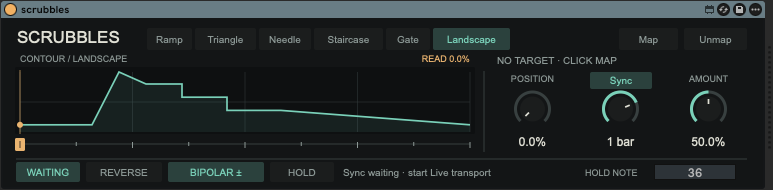

# Scrubbles

A Max for Live MIDI Effect for performing modulation contours: let a shape loop, grab its playhead to scrub, or hold it at a particular value. Map the result to a parameter in Live.

Scrubbles is a traversal prototype, not a synthesizer or contour editor. Its `gen~` engine runs at signal rate; MIDI passes through unchanged.



## Features

- **Six seed contours:** Ramp, Triangle, Needle, Staircase, Gate, and Landscape.
- **Direct scrubbing:** drag the amber ruler beneath the contour to move the playhead. Position provides a separate phase offset.
- **Synced or free-running motion:** follow Live's transport from 1/64 to 4 bars, or select an independent rate in Hz. Bar durations follow Live's time signature.
- **Momentary Hold:** pause traversal with the on-screen button or a MIDI note while retaining manual scrubbing.
- **Traversal and modulation controls:** Run/Stop, Reverse, Amount, and Bipolar/Unipolar output.
- **One mapped Live parameter** per device instance.

## Requirements

- Ableton Live 12.2 or later with Max for Live available.
- Max 9 or later.
- Node.js to rebuild the device or run patch-structure validation.

## Install and try it

1. Clone this repository or download and extract its ZIP. Keep the files together: the device is **unfrozen**, so downloading only `scrubbles.amxd` will not work.
2. Drag `scrubbles.amxd` onto a MIDI track, before an instrument if that track also makes sound.
3. Click **Map**, then click a destination parameter in Live. Use **Unmap** to remove the assignment.
4. Start Live's transport. New instances use the **Landscape** contour with **Sync** enabled and a **1 bar** cycle. Adjust **Amount** to a restrained modulation depth.
5. Drag the amber ruler to scrub. Hold the on-screen **Hold** button to pause traversal, or send MIDI note **36 (C1 in Live)** to the track.

For keyboard Hold, use Monitor **In**, or arm the track with Monitor **Auto**. The **Hold Note** field selects a different note. No Live MIDI mapping or companion device is required.

All MIDI, including the Hold note, reaches downstream devices. Use a dedicated MIDI control track if that note should not also play an instrument.

### Playback behavior

| Action | Sync | Free |
| --- | --- | --- |
| Rate knob | Duration of the entire contour cycle | Cycles per second |
| Release Hold or a playhead grab | Return to Live's grid when both transports are running | Resume from the current position |
| Stop Live's transport | Freeze the playhead and display WAITING | Continue independently of Live's transport |
| Device Stop | Freeze until the device is run again | Freeze until the device is run again |
| Reverse | Mirror the transport phase; position may jump | Reverse travel continuously |

Click **Sync** above the Rate knob to switch to **Free**. Each mode retains its own rate setting. Releasing Hold never enables a stopped device, and releasing one Hold source does not cancel another.

For a simple rhythmic check, choose **Staircase**, **Sync**, and **1 bar** in 4/4: the contour's four steps each occupy a quarter note.

## Build from source

Run from the repository directory:

```sh
node build-device.mjs
node validate_maxpat.mjs scrubbles.maxpat scrubbles-engine.gendsp
```

The build writes `scrubbles.amxd`. Keep it beside these runtime source files:

- `scrubbles.maxpat`
- `scrubbles-engine.gendsp`
- `scrubbles-control.js`
- `scrubbles-ui.js`
- `scrubbles-hold.js`

Keep the device unfrozen during development. After rebuilding, replace the loaded device instance in Live; JavaScript autowatch alone does not reload changed patch connections or saved parameters.

The validator checks patch structure, not Max object semantics or Live behavior. Runtime verification requires loading the device in Max/Live. See [the prototype notes](prototype.md) for the traversal contract and recorded runtime checks.

## Status and design

The current prototype provides fixed, read-only contours. **Note-assigned seek markers**—MIDI notes that jump to chosen contour locations without replacing automatic scanning—are the next recorded direction, not an implemented feature.

Contour editing, segment bending, span, one-shot/ping-pong traversal, multiple contours/destinations, and transport-phase persistence are deferred. See [the design notes](brainstorm.md) for the broader exploration.

The earlier JUCE/VST3 instrument lives under `archive/` and is not part of this device build. `Test Sets/` contains Live projects used during prototype development.

## License

[MIT](LICENSE) — copyright 2026 Travis Briggs.
